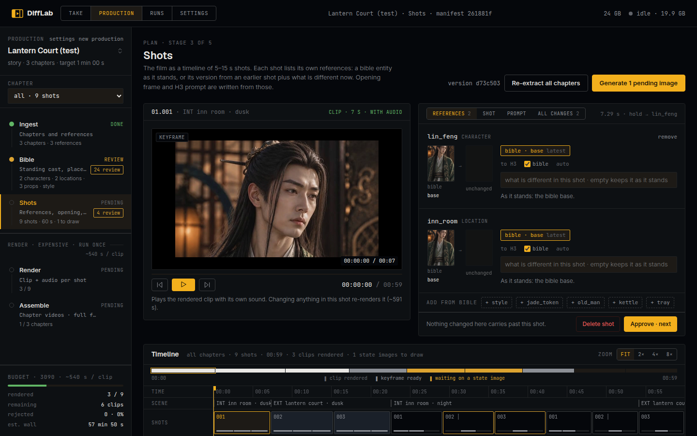
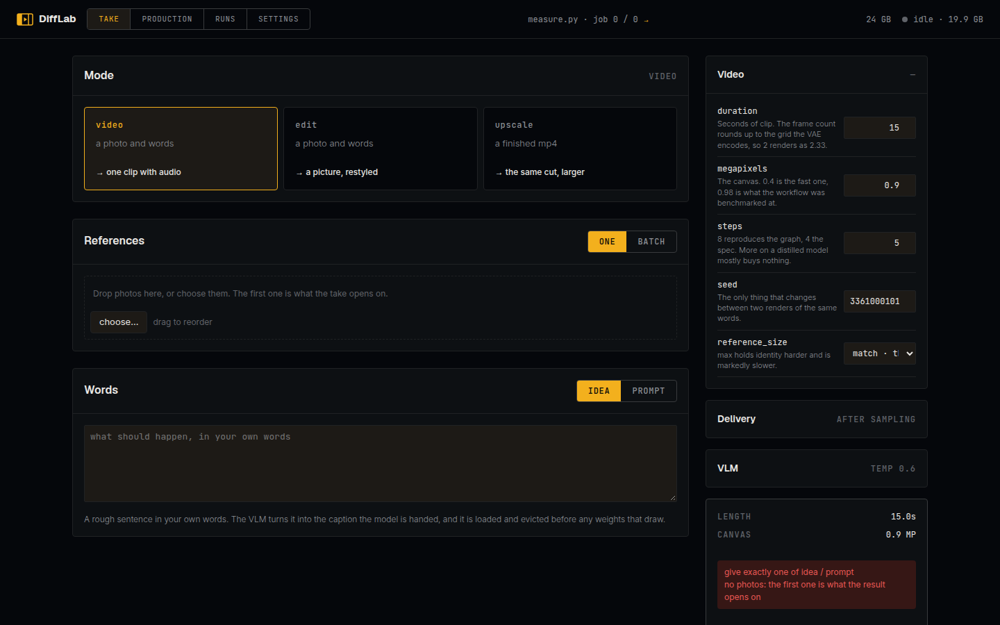
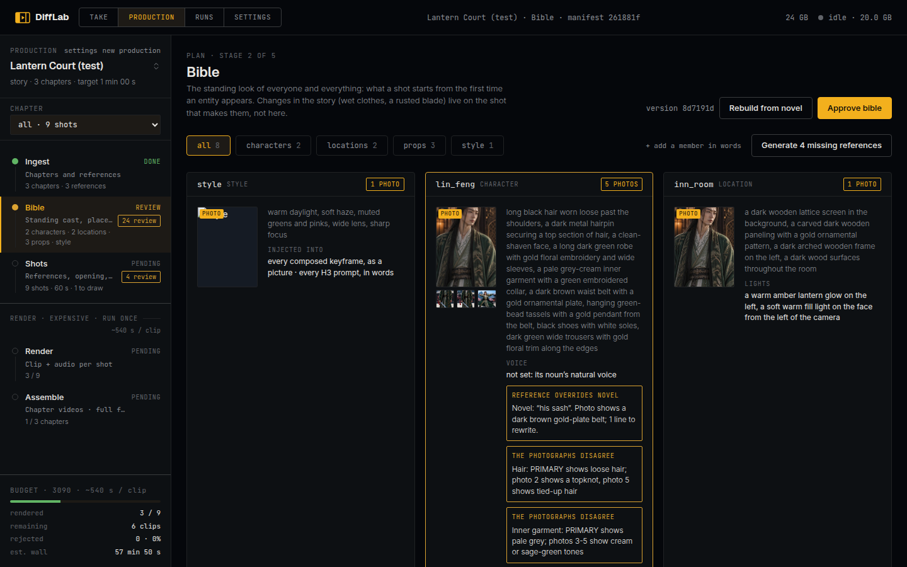
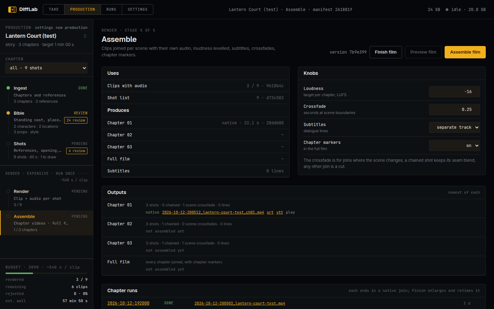
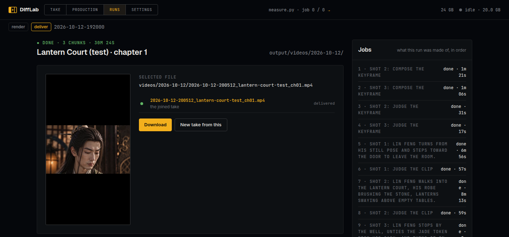
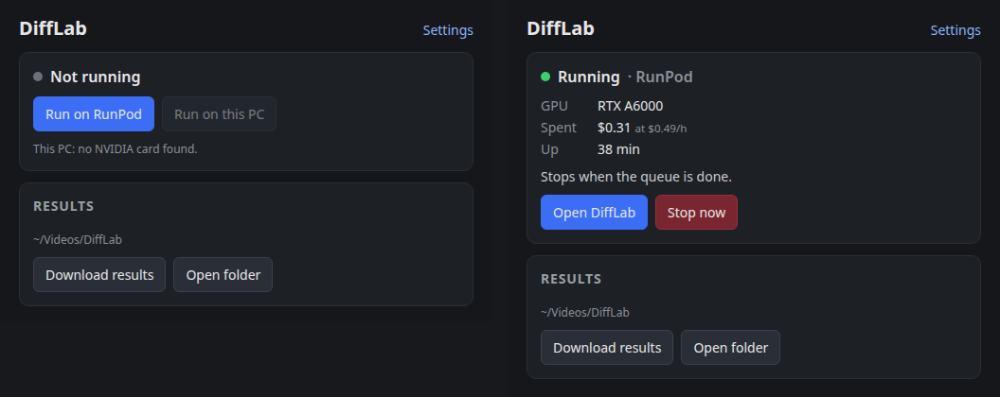

# difflab

A video studio that runs on one graphics card. You give it an idea and a few photographs. It plans a
film shot by shot, draws a first frame for each shot, renders each shot as a clip with its own sound,
and joins the clips into one continuous video, finished at 4K.

Every word comes from one local VLM: plans, prompts and the judging of what was rendered. Pictures
come from Qwen-Image-Edit and video from MiniMax H3. It is plain Python on diffusers and transformers,
with no ComfyUI behind it, and you drive it from a web page.



## What it makes

**Takes** are one-off jobs from a form:

- **video**: a photo and a sentence become one clip with audio.
- **edit**: a photo and a sentence become the photo, changed. An idea with several changes can be
  made in steps. The VLM splits it into one edit per change and judges each picture against the
  photo. A failing step is rewritten from the judge's notes and retried.
- **upscale**: a finished mp4 becomes the same cut, larger.

Every take that makes a video can also be colour-graded (to undo drift across a long take) and
retimed to 48 or 60 fps.



**Productions** are films. A production starts from one of three things:

- an idea and photographs (the director can rewrite a rough idea into a story it renders well),
- a text split into chapters,
- a video to redo shot by shot with a change applied.

It then moves through five stages. Each one shows what is done, what needs review and what went
stale because something it was made from changed:

1. **Ingest**: chapters and reference photos.
2. **Bible**: the standing look of every character, place, prop and style, read from the photos.
   Anything with no photo gets its picture drawn from words.
3. **Shots**: the film as a timeline of 5–15 s shots. Each shot has its references, opening frame and
   prompt, and any of them can be edited or re-rolled.
4. **Render**: a clip with audio per shot. Each clip is judged. A failed one can be retried automatically.
5. **Assemble**: shots joined per chapter, loudness levelled, crossfades at scene changes, subtitles
   and chapter markers. The finish then restores the frames, enlarges them to 4K and retimes them.





Everything that gets made is cached by what it was made from. A run that dies at shot 7 resumes at
shot 7. Re-rolling shot 2 re-renders shots 2 and 3 and nothing else. Running a finished chapter
again renders nothing.

**Runs** lists every job. You can watch a render live, with a preview after every sampling step, and
download the result when it ends. **Settings** picks the models, adds LoRAs from Hugging Face or
Civitai and sets the knobs, for this machine or for one production. Each edit shows what it would
make stale before you commit to it.



## Running it

### The desktop app: your PC or RunPod



`desktop/` is a small app for Windows, macOS and Linux that starts difflab for you:

- **On this PC** if it has the hardware (an NVIDIA card with 24 GB, 64 GB of RAM, and Docker). If it
  doesn't, the app says what is missing.
- **On a RunPod pod** otherwise: an RTX 3090, 4090 or 5090, billed by the second. The first pod creates
  a global volume named `difflab` that any GPU in any region can mount, for projects and results. The
  first pod downloads the models (~96 GB) and keeps a copy on the volume; later pods copy it onto their
  own disk and load from there.

A setup wizard walks through where to run, the RunPod account, storage and the safety limits. After
that the app opens the difflab page and shows the GPU, the money spent, your balance, the image pull
layer by layer and the pod's log. It stops the pod on request or when the queue is done, and the pod
also deletes itself when idle, stuck, or over a spend limit, so closing the app never leaves a GPU
billing. Results download to your PC by themselves while a pod runs.

For RunPod it needs only an API key, kept in the OS keychain. Every push to `main` releases a new
version of the installers and of the image together ([Releases](https://github.com/DiverOfDark/difflab/releases)). To build it yourself, see
[desktop/README.md](desktop/README.md).

### From source

```bash
pixi run serve   # installs everything into .pixi/, builds the page, serves it at http://localhost:8765
```

Needs [pixi](https://pixi.sh), an NVIDIA driver, a CUDA card with 24 GB (developed on an RTX 3090)
and about 32 GB of free RAM; 64 GB is comfortable. Nothing else comes from the system: pixi installs
Python, node, the CUDA 13.3 toolkit and gcc 14 into `.pixi/`. Two packages build from source on the
first install: ExLlamaV3 (no wheel exists for this torch) and comfy-kitchen, built for your card's
architecture as read from `nvidia-smi`, which makes attention 17% faster on a 3090. The build
takes a few minutes.

The first render downloads about 96 GB of models into the Hugging Face cache. After that difflab
never touches the network.

### Docker / RunPod by hand

```bash
docker run --gpus all -p 8765:8765 -v difflab:/app/output -v difflab-models:/models ghcr.io/diverofdark/difflab:latest
```

One image covers every card from Ampere to Blackwell. The database and every output live under
`/app/output`; the weights (~96 GB) under `/models`. Without a volume on `/models`, each new container
downloads the weights again. On RunPod, leave `/models` on the container disk: loaded in place from a
global volume they read about 20 times slower than the Hub sends them. Set
`DIFFLAB_MODEL_STORE=/app/output/.model-store` instead, and each pod copies them whole from the volume
and keeps there whatever it had to download.

**Set `DIFFLAB_TOKEN` on anything public.** Without it there is no login, and a pod's public URL is an
open GPU and a public gallery. The desktop app makes a token for each pod. On RunPod, the server
deletes its own pod according to `DIFFLAB_IDLE_MINUTES`, `DIFFLAB_STUCK_MINUTES`,
`DIFFLAB_SPEND_LIMIT_USD` and `DIFFLAB_EXIT_WHEN_DONE`.

## Models

| Role | Model |
|---|---|
| Every word: plans, prompts, the judge | Qwen3.8-27B abliterated, 4-bit EXL3, on ExLlamaV3 with MTP drafting (70–100 tok/s on a 3090) |
| Pictures: edits, keyframes, references | Qwen-Image-Edit 2511 (Phr00t's Rapid-AIO), or Qwen-Image 2.1 + LoRAs (experimental) |
| Video with audio | MiniMax H3, int8, with a turbo LoRA |
| Finish | SeedVR2 7B (restore), RealESRGAN x2 / 4xLSDIR (enlarge), RIFE 4.26 (frame rate) |

Every default is pinned to a commit (`difflab/core/settings.py`, `difflab/models/minimax_h3/settings.py`).
Each role can be swapped on the Settings page, or for one machine in a git-ignored `.env`, one
`DIFFLAB_MODEL_<ROLE>=repo@commit:path` per role (`VLM`, `EDITOR`, `EDITOR_21_LORAS`, `VIDEO_MODEL`,
`VIDEO_LORAS`, `VIDEO_TEXT_ENCODER`, ...), with `\n` between the lines of a LoRA list.

## Speed (RTX 3090)

| | |
|---|---|
| A 15 s shot at 0.8 MP, 4 steps | ~10 min, the same as ComfyUI on the same checkpoint |
| A 2 MP picture edit | ~30–60 s |
| The 4K finish | ~3 s per frame |
| Peak VRAM while rendering | 8 GB of 24. The model streams from RAM, so RAM matters as much as the card |

## For developers

```
difflab/
  core/        types, settings, cache keys, events, the model registry, downloads
  models/      the model ports: Qwen-Image, MiniMax H3, SeedVR2, ESRGAN, RIFE, the EXL3 VLM
  tools/       one job each: edit, render a shot, judge, hand off, assemble, finish, grade, retime, the director's steps
  screenplay/  productions, chapters, shots, the planner that turns them into jobs, the prompt compiler
  work/        the queue and the worker thread that runs jobs on the card
  store/       SQLite (output/factory.db): runs, jobs, events, productions
  api/         the HTTP server
frontend/      the page (Vue 3 + Vite), built into difflab/api/static
desktop/       the Tauri app
```

```bash
pixi run ruff format && pixi run ruff check && pixi run mypy
npm --prefix frontend run dev    # the page with hot reload, proxying the API
```

Tools take and return plain values, so they compose in a script too:

```python
frame = media.frame_from_image("photo.jpg")
restyled = edit_image.edit(frame, write_prompt.write_edit_instruction(frame, "make it golden hour"))
clip = render_chunk.render(restyled, write_prompt.write_video_prompt(restyled, "she turns and smiles"))
```

Two cache-key facts that are expensive to rediscover:

- A shot is cached by its opening frame's pixels, its prompt's exact text, its settings, its
  references and its motion tail. Each shot opens on the previous shot's last frame, so changing
  one byte of a prompt re-renders that shot and every shot chained after it.
- The handoff's colour anchor (`Continuity.color_anchor`) changes the opening frame, so turning it on
  re-renders every shot after the first. A grade on the finished file fixes the same drift with no
  re-render.
